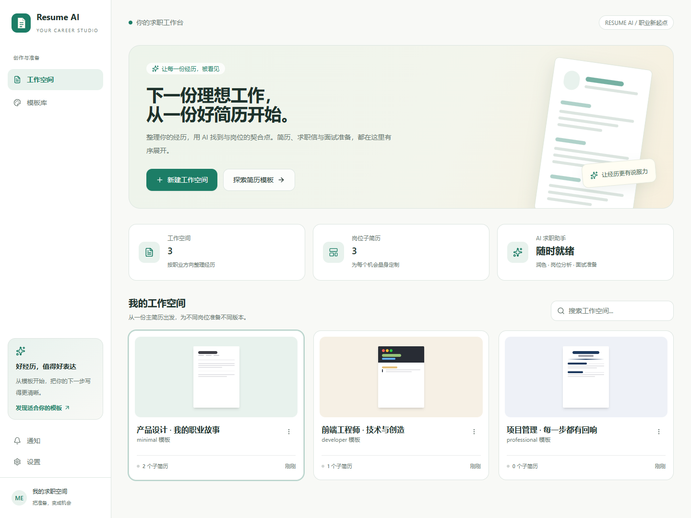

# Resume AI

一个把简历编辑、岗位分析和面试准备放在一起的 AI 求职工作台。

使用米白纸感背景、青绿色主色与清晰的卡片布局，让每一份经历都有合适的表达方式。首次打开默认使用亮色主题，也可以在「设置 → 外观」中切换暗色或跟随系统。

## 功能

- **简历工作空间**：管理主简历和针对不同岗位的子简历，支持搜索、重命名和删除。
- **模块化编辑**：区块与条目拖拽排序、显示隐藏、主题配置、自动保存和多模板实时预览。
- **PDF 导入**：提取简历文本，借助大模型转换为结构化内容。
- **AI 简历助手**：用自然语言查询、新增、修改简历区块，优化表达或翻译简历。
- **JD 岗位分析**：提取岗位画像，评估匹配情况、展示证据与差距并生成优化建议。
- **模拟面试**：按岗位与简历配置多轮面试，支持流式问答、提示、跳题和总结。
- **求职材料生成**：生成与岗位相关的求职信和招聘平台招呼语。
- **文件导出**：支持 PDF、TXT、JSON；PDF 通过 Chromium 渲染并等待字体加载。

## 界面设计

本版本以 **Paper & Sage（纸感与鼠尾草绿）** 为视觉方向：

- 米白背景、白色内容卡片、青绿色交互主色。
- 首页加入求职准备引导、真实工作空间统计、搜索与空状态。
- 响应式工作空间网格；窄屏侧栏收起文字，保留导航按钮。
- 统一应用按钮、选中态、输入框焦点与品牌图标；简历模板保留自己的排版与配色。
- 首页具备加载失败提示和重新加载入口。



预览图使用演示数据展示布局；实际工作空间来自本地后端。

## 技术栈

| 模块 | 技术 |
| --- | --- |
| 前端 | React 19、TypeScript、Vite 8、Tailwind CSS 3 |
| 状态与组件 | Zustand、TanStack Query、Radix UI、dnd-kit、Lucide |
| 后端 | Python 3.13、FastAPI、SQLAlchemy Async、SQLite |
| AI 调用 | OpenAI 兼容接口、Anthropic 接口、Pydantic、JSON 修复 |
| 解析与导出 | PyMuPDF、Playwright / Chromium |
| 实时通知 | SSE、异步任务事件队列 |

## 本地启动

### 环境要求

- Node.js **22.12+**（建议使用较新的 LTS 版本）
- Python **3.13+**
- [uv](https://docs.astral.sh/uv/) Python 包管理器

### 1. 获取代码

```bash
git clone https://github.com/tanxiangxin/resume-ai.git
cd resume-ai
```

### 2. 启动后端

```bash
cd backend
uv sync
uv run playwright install chromium
uv run uvicorn main:app --host 127.0.0.1 --port 8000
```

数据库在启动时自动初始化，默认保存在 `backend/app.db`。接口文档地址为 <http://localhost:8000/docs>。

### 3. 启动前端

在另一个终端执行：

```bash
cd frontend
npm ci
npm run dev -- --host 127.0.0.1
```

打开 <http://localhost:5173>。当前前端 API 和任务通知使用 `http://localhost:8000`，请同时启动后端。

### 4. 配置模型

在左侧「设置 → AI 配置」中选择 OpenAI 或 Anthropic 协议，填写 API 地址、API Key 和模型名称。兼容 OpenAI 协议的服务可使用自己的 Base URL。

不调用模型也可以创建空白简历、选择模板及编辑内容；PDF 智能解析、岗位分析、AI 优化与模拟面试需要有效的模型配置。

## 构建与检查

```bash
cd frontend
npm run build
npm run lint
```

`build` 执行 TypeScript 检查并输出静态文件到 `frontend/dist`；`lint` 检查前端代码规范。

本次改版的构建、浏览器检查与已有 lint 问题记录见 [VERIFICATION.md](VERIFICATION.md)。

后端测试：

```bash
cd backend
uv run pytest
```

## 目录结构

```text
resume-ai/
├── assets/                       # 页面预览
├── backend/
│   ├── apps/                     # 简历、JD、面试、助手、导出等业务
│   ├── chiren_backend/
│   │   ├── api/                  # 应用入口、路由与生命周期
│   │   └── platform/             # 数据模型、数据库、LLM 与任务基础设施
│   ├── shared/types/             # 共享数据类型
│   ├── tests/                    # 后端测试
│   └── pyproject.toml
└── frontend/
    ├── src/
    │   ├── components/           # 编辑器、模板、工作空间与通用组件
    │   ├── pages/                # 工作台、详情、编辑与面试页面
    │   ├── stores/               # Zustand 状态
    │   ├── lib/                  # API、主题与工具函数
    │   ├── index.css             # 全局样式与主题变量
    │   └── studio.css            # 亮色工作台布局与装饰
    └── package.json
```

## 项目来源

本项目基于 [zhangzhenxiang666/Chiren](https://github.com/zhangzhenxiang666/Chiren) 进行界面与文档定制，保留原有 Git 历史和后端模块名称。当前仓库维护 Resume AI 的品牌、亮色工作台与使用说明。
